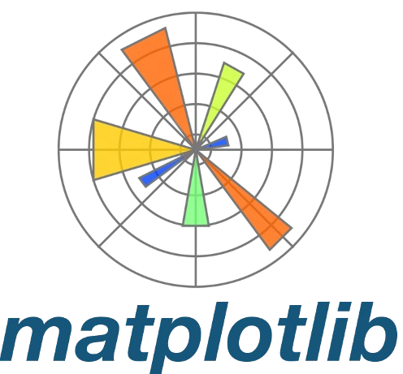
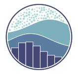
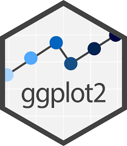

# 👋 Introduction

Welcome to our webpage of **Exploratory Data Analysis (EDA) and Unsupervised Learning**! This course is designed to equip you with the essential skills and techniques to explore and understand your data before diving into more complex analysis including modeling tasks. By the end of this session, you will be adept at uncovering crucial insights hidden within the data and leveraging this knowledge to guide your analysis effectively. You will approach data analysis with a clear objective, applying a variety of techniques to understand, interpret, and make informed decisions based on the data. Additionally, you will be able to present your findings visually, making them accessible for both technical and general audiences.

[*"Data are just like corpses, and EDA provides us tools to question them. — Well, that's how I look at it!"*]{style="color: #2558afff;"}

--------------

# 📝 Course Criteria

| **`Criteria`** | **`Percentage`** |
|:----------|:----------:|
|Attendance | 10% |
|Quiz & labs | 20% |
|Midterm Exam | 20% |
|Final Exam | 20% |
|Final Project| 30% |

## ⌨️ Programming: 

> You are free you use your favorite programming language [{width=30px style="position: relative; bottom: 0px"}](https://www.python.org/){target="_blank"} `Python` or [{width=30px style="position: relative; bottom: 0px"}](https://www.r-project.org/){target="_blank"}...

::: {.panel-tabset}
## `Python`

- [{width=30px style="position: relative; bottom: 0px"} Jupyter Notebook](https://docs.jupyter.org/en/latest/){target="_blank"} 
- [{width=30px style="position: relative; bottom: 0px"} Google colab](https://colab.research.google.com/){target="_blank"}
- [{width=35px style="position: relative; bottom: 0px"} Matplotlib](https://matplotlib.org/){target="_blank"}
- [{width=30px style="position: relative; bottom: 0px"} Seaborn](https://seaborn.pydata.org/){target="_blank"}

## `R`

- [{width=60px style="position: relative; bottom: 0px"} Rmarkdown/Quarto](https://quarto.org/){target="_blank"}
- [{width=25px style="position: relative; bottom: 0px"} Posit cloud](https://ggplot2.tidyverse.org/){target="_blank"}
- [{width=27px style="position: relative; bottom: 0px"} Ggplot2](https://ggplot2.tidyverse.org/){target="_blank"}
- [{width=30px style="position: relative; bottom: 0px"} Tidyverse](https://www.tidyverse.org/){target="_blank"}

:::

-----------

# 📋 Course session

| **Note**: The following table of contents will be progressively updated according to the course advancement. **To covert `html` slide to `PDF`, you can simply just click on the slide then press letter `E` on your keyboard then save the rendered `PDF` slide**.

<!-- ==== MDAS ==== --->

| Topic                | TP    | Solution | Remark         |
|:---------------------|:------|:---------|:---------------|
| [1. Introduction to EDA & Univariate Analysis](https://hassothea.github.io/M1_DAS_EDA_ITC/docs/01-Intro-eda-and_univarate-analysis.html#/title-slide){target='_blank'} | TP1 | Solution1 | ...Loading |

<!-- ===== Engineering ======= -->

<!-- | Topic                | TP    | Solution | Remark         |
|:---------------------|:------|:---------|:---------------|
| [1. Introduction to EDA & Univariate Analysis](https://hassothea.github.io/I5_EDA_ITC/docs/01-Intro-eda-and_univarate-analysis.html#/title-slide){target='_blank'} | [TP1](https://hassothea.github.io/I5_EDA_ITC/TPs/TP1_Variable_Types_Descriptive_Statistics.html){target="_blank"} | Solution1 | ✅ Completed |
| [2. Bivariate Analysis](https://hassothea.github.io/I5_EDA_ITC/docs/02-bivariate-analysis.html){target='_blank'} | [TP2](https://hassothea.github.io/I5_EDA_ITC/TPs/TP2_Bivariate_Analysis.html){target='_blank'} | Solution2 | `...loading` | -->

# 📋 Midterms, Exams and Projects

In this section, you will find all the information related to the midterms, exams and projects including instructions, starting dates and the deadlines.

## ✏️ Project:

- ⏱️ Deadline for the report: `...Loading`.
- ✉️ Where to submit: `...Loading`
- 📝 Your report should be in (your favorite) **PDF** format and include the following criteria:
  - **Members' names & contributions**.
    - Clearly state each member’s contribution to the report.
    - For example:
      - **Luffy**: Introduction, Data Preprocessing
      - **Gojo**: Exploratory Data Analysis, Model Development
      - **Naruto**: Results and Evaluation, Conclusion
  - **Introduction**:
    - Clearly state the objectives and purpose of the analysis.
    - Provide a brief descriptive statistics of the dataset.
  - **Data Preprocessing**:
    - Detail steps taken to clean and preprocess the data.
    - Explain handling of missing values and outliers.
    - Describe any feature engineering techniques applied.
  - **Exploratory Data Analysis (EDA)**:
    - Include visualizations (charts, graphs) and descriptive statistics.
    - Identify key patterns, trends, and anomalies in the data.
  - **Unsupervised/supervised Tasks**:
    - Exploring structures or connections of the data according the flow of your analysis.
    - Provide details on clustering methods or model training, validation, and testing processes.
    - Include any choice of parameters of unsupervised tasks or hyperparameter tuning and model optimizations.
  - **Results and Evaluation**:
    - Present the resulting performance (e.g., obtained structures or accuracy, precision, recall, F1-score, RMSE).
    - Compare performance across different methods if multiple were used.
    - Highlight any insights or conclusions drawn from the implemented methods/models.
  - **Conclusion**:
    - Summarize key findings and their implications.
    - Discuss any limitations of the analysis.
    - Suggest potential areas for future research or improvement.
  - **References**:
    - Cite all sources of data and any external libraries or tools used.
    - Include academic references for any theoretical concepts or methods applied.
  - **Appendix (Optional)**:
    - Provide additional figures, tables, or code snippets that support the analysis.
- **Presentation**: 
  - A possible dates: `...Loading`.

------------

# 📚 Resources and Further Reading

Here, you will find additional resources, including books, research papers, and online courses, to further your understanding of **Exploratory Data Analysis and Unsupervised Learning**.

👉 You will find these books/links helpful...

- [Exploratory-Data-Analysis-with-Python-Cookbook](https://github.com/PacktPublishing/Exploratory-Data-Analysis-with-Python-Cookbook?tab=readme-ov-file){target="_blank"}

- [Handbook of Data Visualization, Chen et al.](https://haralick.org/DV/Handbook_of_Data_Visualization.pdf){target="_blank"}

- [Python for Data Analysis, Wes M.](https://wesmckinney.com/book/){target="_blank"}

- [Exploratory Data Analysis with R, Roger D. Peng](https://bookdown.org/rdpeng/exdata/){target="_blank"}

- [R for Data Science, Hadley W. and Garrett G.](https://batrachos.com/sites/default/files/pictures/Books/Wickham_Grolemund_2017_R%20for%20Data%20Science.pdf){target="_blank"}

------
